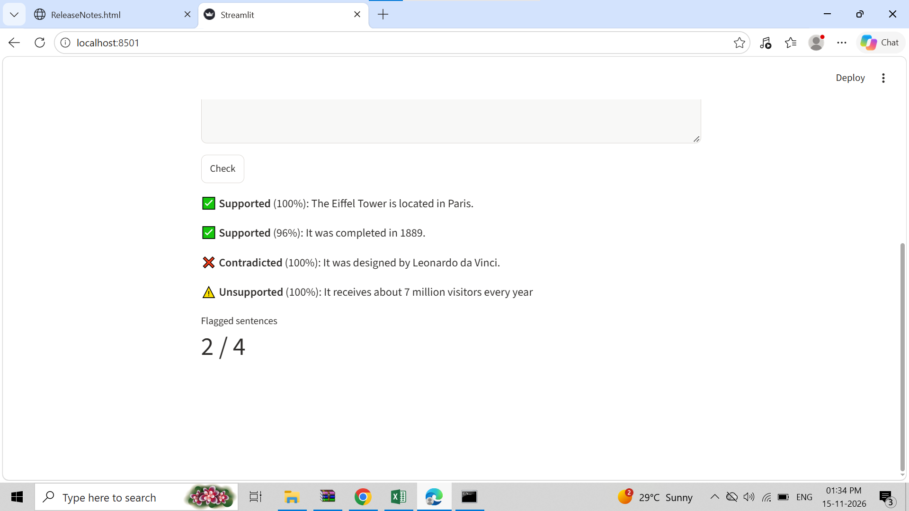

# LLM Hallucination Detector

A tool that checks whether each sentence of an AI-generated answer is supported by a source text. It flags unsupported or contradicted claims as possible faithfulness hallucinations.

## Background
Built from my literature review on hallucination detection and mitigation in LLMs (paper presentation, Byte Brigade Club NovaScript). The tool implements the "evidence grounding" detection family.

## How it works
1. The source text is split into overlapping chunks of sentences.
2. Each answer sentence is compared with every chunk using a Natural Language Inference model (cross-encoder/nli-deberta-v3-small).
3. A sentence is labeled Supported, Contradicted or Unsupported based on the highest entailment/contradiction probability.

## Run it
pip install streamlit transformers torch
python -m streamlit run app.py

## Limitations
- Only checks faithfulness to the given source, not real-world facts.
- Short chunks can miss claims that need information from distant parts of the source.
- The NLI model can make mistakes on complex or numeric claims.

## Future improvements
- Add uncertainty scores
- Support PDF upload
- Add a factual check using external knowledge
